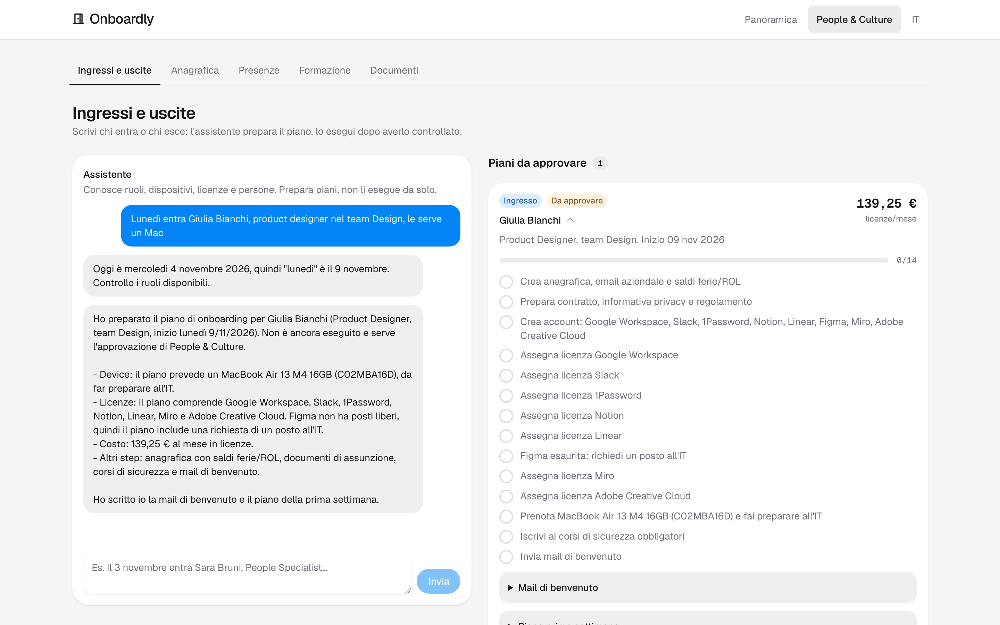
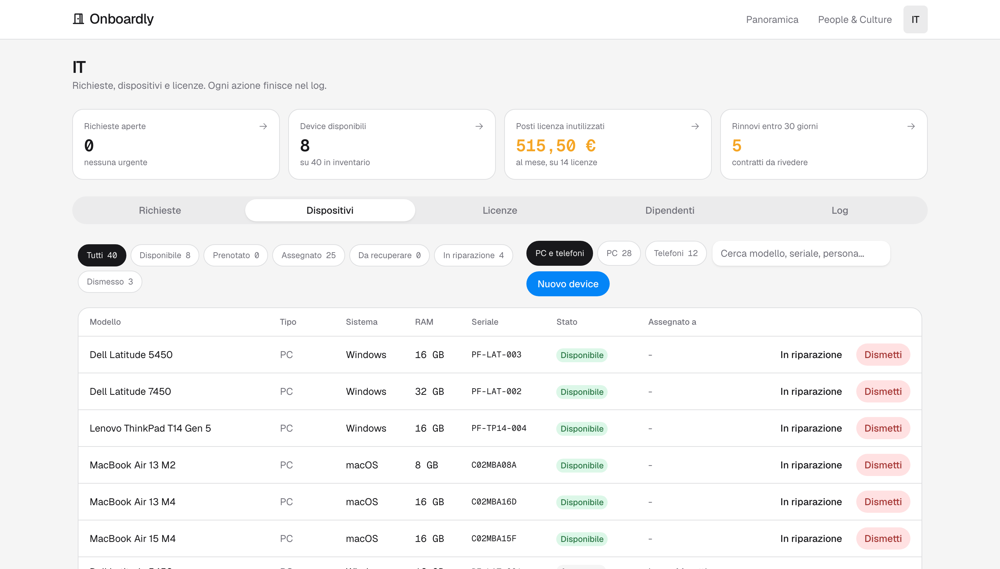

<div align="center">


# Onboardly

**Ingressi e uscite del personale con un assistente AI che prepara il piano e una persona che lo approva.**

[Apri la demo](https://onboardly-demo.vercel.app) · [Specifica](docs/SPEC.md) · [Setup](docs/SETUP.md)

<sub>Progetto dimostrativo, dati di prova.</sub>

</div>

<br>



## In breve

People & Culture scrive una frase come *"lunedì entra Giulia Bianchi, product designer nel team Design, le serve un Mac"*. L'assistente controlla ruoli, dispositivi e licenze disponibili, chiede quello che manca e propone un piano completo. Il piano resta in attesa finché qualcuno non lo approva: solo allora l'app assegna il portatile, attiva le licenze e manda le mail.

Per provarla basta aprire la [demo](https://onboardly-demo.vercel.app) e premere **Entra nella demo**. Nessuna registrazione.

## Il problema

Un ingresso o un'uscita coinvolge HR, IT e il responsabile del team, ognuno con i suoi strumenti. Il risultato tipico:

- checklist sparse tra fogli, mail e chat;
- licenze pagate per persone che non lavorano più in azienda;
- portatili non restituiti dopo un'uscita;
- nuovi assunti che il primo giorno non hanno accesso a niente.

Onboardly mette tutto in un unico flusso, con un registro di ogni azione.

## Cosa fa

| Area | Cosa trovi |
| --- | --- |
| **Onboarding** | Dispositivo adatto al ruolo, licenze con costo mensile, account, documenti di assunzione, corsi di sicurezza, mail di benvenuto e piano della prima settimana. Se mancano dispositivi o posti licenza apre una richiesta all'IT. |
| **Offboarding** | Sospensione degli account alla data giusta, licenze da rilasciare con il risparmio mensile, riconsegna dei dispositivi (anche via corriere con etichetta prepagata), ferie e permessi da liquidare, mail di uscita. |
| **Area IT** | Inventario dispositivi, licenze e rinnovi, richieste aperte, registro delle azioni. |
| **People & Culture** | Anagrafica, presenze e assenze, archivio documenti, formazione obbligatoria. |



## Come funziona

```
  Richiesta in italiano  ──▶  Assistente AI  ──▶  Piano proposto  ──▶  Approvazione  ──▶  Esecuzione
  "lunedì entra Giulia"       legge i dati,       device, licenze,     una persona        il codice
                              chiede ciò che      account, mail        controlla e        assegna, attiva
                              manca                                    approva            e registra
```

Il principio di base è **l'AI propone, il codice esegue**. L'assistente ha solo strumenti di lettura e uno strumento per proporre un piano: non può assegnare un portatile né attivare una licenza. Tutte le modifiche ai dati passano dal codice dell'app, dopo l'approvazione, dentro transazioni e con una voce nel registro.

## Come l'ho sviluppata

Requisiti, specifica, scelte di prodotto e test sono miei. Il codice è stato scritto con [Claude Code](https://claude.com/claude-code), lavorando per passi piccoli: per ogni passo ho definito cosa doveva succedere, ho verificato il risultato nell'app e con i test, e solo dopo ho fatto il commit.

La documentazione di lavoro è nel repo:

- [`docs/SPEC.md`](docs/SPEC.md): specifica funzionale
- [`docs/DESIGN.md`](docs/DESIGN.md): linee guida dell'interfaccia
- [`docs/SETUP.md`](docs/SETUP.md): configurazione, deploy e problemi incontrati

## Stack

| | |
| --- | --- |
| **Frontend** | Next.js 16 (App Router), React 19, TypeScript |
| **Interfaccia** | HeroUI v3, Tailwind CSS v4, icone Phosphor |
| **Dati** | PostgreSQL su Neon (region UE), Prisma 7 |
| **AI** | Claude API con tool use |
| **Deploy** | Vercel, funzioni nella region `fra1` (Francoforte) |

## Avvio in locale

Servono Node.js 24 e un database Postgres (va bene un progetto Neon gratuito).

```bash
cp .env.example .env.local   # inserisci DATABASE_URL e ANTHROPIC_API_KEY
npm install                  # esegue anche prisma generate, che legge DATABASE_URL
npx prisma migrate dev
npm run db:seed              # carica i dati di prova
npm run dev
```

L'app è su http://localhost:3000. In locale l'accesso è libero; se imposti `DEMO_PASSWORD` compare la pagina di accesso con il bottone **Entra nella demo**.

| Comando | |
| --- | --- |
| `npm test` | test |
| `npm run lint` | lint |
| `npm run build` | build di produzione |

## Autore

Marco Parolin
